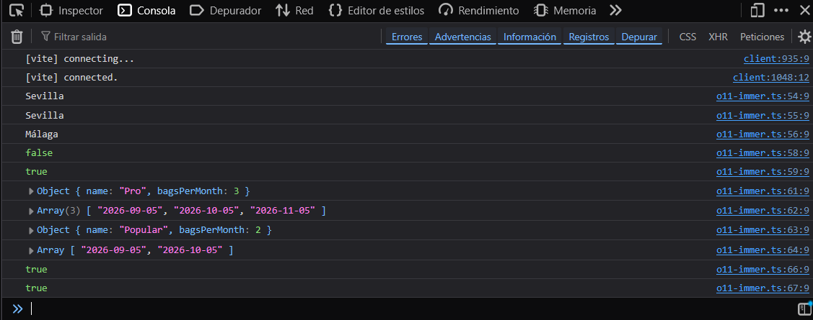

# 🧪 Laboratorio · Módulo 02 · JavaScript y TypeScript

Katas de TypeScript sobre el catálogo de **Tueste** ☕: tipos, funciones, destructuring, opcionales, métodos de arrays, inmutabilidad, uniones y genéricos, tipos de utilidad, closures e Immer.

## 🚀 Cómo arrancarlo

```bash
npm install
npm run dev
```

Vite muestra una dirección (normalmente `http://localhost:5173`). La página está vacía: **la salida de las katas se ve en la consola del navegador** (F12 → pestaña **Console**).

Cada kata está en su propio fichero dentro de `src/`. Para elegir cuál se ejecuta, en [src/main.ts](src/main.ts) se descomenta su `import` (y se comentan los demás):

```ts
// import "./o10-closures";
import "./o11-immer";
```

## 📸 Salida en la consola



## ✅ Comprobación de tipos

Vite no comprueba los tipos, así que lo hago aparte con:

```bash
npx tsc
```

Sale **sin errores**.

## 🧪 Tests (P1)

Las salidas esperadas de O5 (arrays) y O6 (carrito) están convertidas en tests con [Vitest](https://vitest.dev/). Vitest lo instalé yo; los tests los escribió la IA (Claude Code) a partir de mis `console.log`, y después los revisé y ejecuté:

- [src/o05-arrays.test.ts](src/o05-arrays.test.ts): `availableCoffees`, `catalogLabels` (incluido que no desordena el catálogo original) y `stockValue`.
- [src/o06-carrito.test.ts](src/o06-carrito.test.ts): `addToCart`, `changeQuantity`, `removeFromCart` y `cartTotal`, además de comprobar que no se modifican los carritos anteriores y que solo se copia lo que cambia.

```bash
npm test
```

Vitest busca todos los ficheros `*.test.ts` y se queda vigilando: al guardar un cambio, vuelve a ejecutar los tests (se sale con `q`). Para ejecutarlos una sola vez: `npx vitest run`.

Resultado: **14 tests, todos en verde**.

Para comprobar la inmutabilidad he usado los dos tipos de comparación de Vitest:

- `toEqual` compara el **contenido**: sirve para ver que el carrito original sigue igual después de llamar a `addToCart`.
- `toBe` compara con `===`, es decir, si es **el mismo objeto en memoria**: sirve para ver que el café que no cambió se comparte entre el carrito viejo y el nuevo, y que el que cambió es un objeto nuevo (`not.toBe`).

Para los precios uso `toBeCloseTo`, porque con decimales el resultado puede ser algo como `58.31999999`.

## ↩️ P2 · Deshacer en el carrito

En [src/p02-historial.ts](src/p02-historial.ts), `createCartHistory` guarda dentro de un closure una lista con todos los carritos por los que se ha pasado. Como `addToCart` crea siempre un carrito nuevo sin tocar el anterior, guardar el historial es solo guardar esas referencias:

- `add` añade al final el carrito nuevo.
- `undo` quita el último (nunca el carrito vacío inicial).
- `current` devuelve el último.

Lo escribió la IA (Claude Code) y me lo explicó paso a paso.

## ❓ P5 · Datos desconocidos con `unknown`

En [src/p05-unknown.ts](src/p05-unknown.ts), `isCoffee` recibe un dato `unknown` (como el resultado de `JSON.parse`) y comprueba cada propiedad de `Coffee` sin usar `as`:

- `typeof data === "object" && data !== null` para saber que es un objeto (`typeof null` también da `"object"`).
- `"id" in data` para saber que la propiedad existe; a partir de ahí TypeScript deja usar `data.id`.
- `typeof` para el tipo de cada propiedad, `Array.isArray` para `notes` y una lista de valores válidos para `roast`.
- `discount` es opcional: vale si no está o si es un número.

El ejemplo del enunciado da `false` (le faltan `origin`, `notes`, `roast` y `stock`). Uno completo da `true`, y `null` o un texto dan `false`. Lo escribió la IA (Claude Code) y me lo explicó.

## 💳 D2 · Uniones discriminadas

En [src/d02-pagos.ts](src/d02-pagos.ts), `PaymentMethod` es una unión de tres objetos (tarjeta, Bizum y transferencia) que comparten la propiedad `type`. `describePayment` hace un `switch` sobre `method.type`, y dentro de cada `case` TypeScript sabe qué propiedades existen: en `"card"` deja usar `method.last4`, pero no `method.phone`.

El `default` llama a `assertNever(method)`, una función que solo acepta el tipo `never`. Si se cubren todos los casos, al `default` no llega ningún método y `method` es `never`. Para comprobarlo, añadí al tipo un método `paypal` sin su `case`, y TypeScript dio este error:

> Argument of type '{ type: "paypal"; email: string; }' is not assignable to parameter of type 'never'.

Así, si alguien añade un método de pago y se olvida de contemplarlo, el error aparece al compilar y no cuando un cliente intenta pagar.

## ⏱️ D3 · El coste de la inmutabilidad

En [src/d03-inmutabilidad.ts](src/d03-inmutabilidad.ts) lleno un array con los números del 0 al 19 999 de dos formas y mido cada una con `performance.now()`:

| Bucle de 20 000 vueltas | Tiempo |
| ----------------------- | ------------ |
| `list = [...list, i]`   | **2244 ms**  |
| `list.push(i)`          | **1 ms**     |

**Por qué el spread es tan lento:** `[...list, i]` copia el array entero en cada vuelta y después añade el número nuevo. Con 4 vueltas se ve bien:

| Vuelta | Qué hace                  | Elementos copiados |
| ------ | ------------------------- | ------------------ |
| i = 0  | `[]` → `[0]`              | 0                  |
| i = 1  | copia `[0]` y añade el 1   | 1                  |
| i = 2  | copia `[0,1]` y añade el 2 | 2                  |
| i = 3  | copia `[0,1,2]` y añade el 3 | 3                |

Cada vuelta copia un elemento más que la anterior. Con 20 000 vueltas, la suma 0 + 1 + … + 19 999 da unos **200 millones** de copias. `push` no copia nada: añade el número al mismo array, así que son 20 000 operaciones.

**Por qué `map` no tiene este problema:** `map` también devuelve un array nuevo, pero lo crea **una sola vez**. Recorre el original y va metiendo cada resultado en ese único array nuevo, así que con 20 000 elementos hace 20 000 operaciones. Lo caro no es crear un array nuevo, sino copiar el array entero en cada vuelta de un bucle.

## 🔁 D5 · Mi propio `reduce`

En [src/d05-reduce.ts](src/d05-reduce.ts) está `myReduce`, hecho con un bucle `for` y sin el `reduce` nativo. En cada vuelta, el acumulador se sustituye por lo que devuelve el `reducer`: `acc = reducer(acc, items[i])`. Con él reescribí `stockValue` (sale `585.60`) y `countByRoast` (sale `{ light: 2, medium: 2, dark: 2 }`).

Este desafío lo escribió la IA (Claude Code) porque me atasqué. Después me explicó cada línea comparándola con mi `myMap` de P6.

## 📝 Respuestas a las preguntas 📝 y 🔍

Están como comentarios en el código. Resumen y enlace a cada una:

| Kata   | Pregunta                                    | Respuesta                                                                                                                                                                                                                                    |
| ------ | ------------------------------------------- | -------------------------------------------------------------------------------------------------------------------------------------------------------------------------------------------------------------------------------------------- |
| O2 🔍  | Quitar un `case` del `switch`               | TypeScript da _"Function lacks ending return statement…"_: con el tueste que falta, la función no devolvería nada. [Ver comentario](src/o02-funciones.ts#L29)                                                                                |
| O3 📝  | El `...` que no es rest                     | Es **spread**: reparte el array de stocks en argumentos separados para `sumAll`. [Ver comentario](src/o03-destructuring.ts#L42)                                                                                                              |
| O5 🔍  | Cambiar `toSorted` por `sort`               | El catálogo no se desordenó porque `sort` se aplicaba sobre la copia que crea `filter`, no sobre `coffees`. Con `coffees.sort(...)` sí cambiaría el original. [Ver comentario](src/o05-arrays.ts#L43)                                        |
| O8 🔍  | Borrar `delivered` y tipos de `findById`    | Error _"Property 'delivered' is missing…"_ porque `Record<OrderStatus, string>` exige todas las claves. `findById` devuelve `Coffee \| null` con cafés y `Customer \| null` con clientes. [Ver comentario](src/o08-uniones-genericos.ts#L12) |
| O10 📝 | `.map(blackFriday)` sin paréntesis y pureza | Se pasa la función, no se llama: la llama `map` con cada precio. `blackFriday` es pura; `nextOrderId` no, porque devuelve algo distinto en cada llamada. [Ver comentario](src/o10-closures.ts#L30)                                           |
| O11 📝 | ¿Spread o Immer?                            | Immer es más legible con datos anidados. Spread, para cambios en el primer nivel o si no quiero añadir una librería. [Ver comentario](src/o11-immer.ts#L69)                                                                                  |

## ☑️ Checklist

### Obligatorios

- [x] O1 · Tipar el catálogo
- [x] O2 · Funciones básicas
- [x] O3 · Destructuring y rest
- [x] O4 · Datos que pueden faltar
- [x] O5 · Métodos de arrays
- [x] O6 · El carrito inmutable
- [x] O7 · ¿Pura o impura?
- [x] O8 · Uniones, Record y genéricos
- [x] O9 · Tipos de utilidad
- [x] O10 · Closures
- [x] O11 · Immer
- [x] O12 · README + bitácora de IA

### Opcionales

- [x] P1 · Tests con Vitest
- [x] P2 · Deshacer en el carrito
- [x] P3 · Agrupar con `reduce`
- [x] P4 · Ordenar por cualquier propiedad
- [x] P5 · Datos desconocidos con `unknown`
- [x] P6 · Vuestros propios `map` y `filter`
- [ ] P7 · Modelad los datos de vuestro TFM

### Desafíos

- [ ] D1 · Pintad el catálogo en la landing del módulo 1
- [x] D2 · Uniones discriminadas
- [x] D3 · Medid el coste de la inmutabilidad
- [ ] D4 · Un pedido como en React (reducer con Immer)
- [x] D5 · Vuestro propio `reduce`

## 🤖 Bitácora de IA

**Herramienta:** Claude Code (extensión de VS Code). La usé sobre todo como profesor: le pedía que me explicara cada kata paso a paso, yo escribía el código y después le pedía que lo revisara. En algunos puntos en los que me atasqué le pedí que lo hiciera ella y me lo explicara (lo indico en cada ejemplo).

### Ejemplo 1 · O9, quitar el `as` de `countByRoast`

#### Prompt

"Puedes revisar o09-utilidad.ts a ver si está todo bien?"

#### Qué me dio

Las salidas eran correctas, pero me señaló un problema en `countByRoast`: el valor inicial era `{} as Record<Roast, number>`.

#### Qué corregí y por qué

Con `as` le decía a TypeScript que un objeto vacío era un `Record<Roast, number>`, que es falso: si no hubiera ningún café `dark`, faltaría esa clave. Le pedí que aplicara la mejora: el valor inicial pasó a ser `{ light: 0, medium: 0, dark: 0 }`, sin `as` y sin el `|| 0`.

### Ejemplo 2 · O7, ¿por qué `createOrderIdPure` es pura si el resultado cambia?

#### Prompt

"Pero `timestamp` también va a cambiar en cada llamada. Es eso lo que no entiendo."

#### Qué me dio

Para hacer pura `createOrderId`, que usa `Date.now()` por dentro, la IA me propuso pasar la hora como parámetro: `createOrderIdPure(timestamp)`, llamada como `createOrderIdPure(Date.now())`. Yo no lo veía claro: el resultado seguía siendo distinto en cada llamada, así que no entendía qué se ganaba. Se lo planteé y me explicó la regla exacta de la pureza: no es "devolver siempre lo mismo", sino "con los mismos datos de entrada, el mismo resultado". Me lo comparó con `doble(5)` y `doble(6)`: dan resultados distintos porque reciben datos distintos, y nadie diría que `doble` es impura.

#### Qué corregí y por qué

Corregí mi idea de qué es una función pura. `createOrderId()` es impura porque, llamada exactamente igual, devuelve cosas distintas: depende de un reloj que está fuera de ella. `createOrderIdPure(1000)` devuelve siempre `"ORD-1000"`. La impureza (mirar la hora) no desaparece, pero sale de la función y queda a la vista en la llamada. Lo que se gana es que el resultado se puede predecir y comprobar, que es lo que permite escribir tests. Es el mismo truco que en la función 1 de O7 con `shippingCost`: lo que viene de fuera se recibe como parámetro.

### Ejemplo 3 · O11, copiar con spread

#### Prompt

"Me quedé en la parte O11 · Immer. Podrías explicármela para poder hacerla paso a paso?"

#### Qué me dio

Una explicación de la copia superficial y un esqueleto de `movedSpread` con huecos (`???`) para rellenar cada nivel.

#### Qué corregí y por qué

Escribí `movedSpread` como una función, pero tenía que ser una constante: los `console.log` del enunciado usan `movedSpread.customer...` sin paréntesis. Además, no entendía dónde iba cada spread. La explicación no me sirvió hasta que le pedí otro enfoque: escribir primero el objeto completo a mano y luego sustituir lo que se repite por `...subscription`, `...subscription.customer` y `...subscription.customer.address`. Así entendí que hace falta un spread por cada objeto en el camino hasta el dato que cambia.
